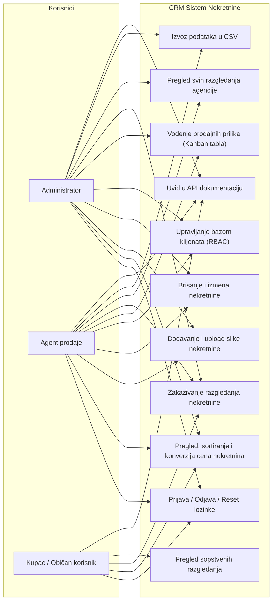
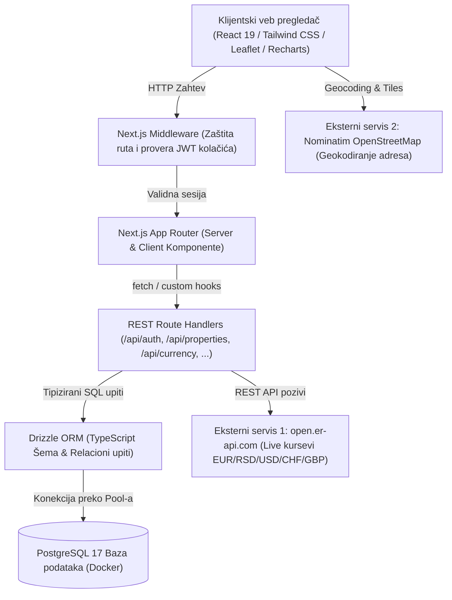
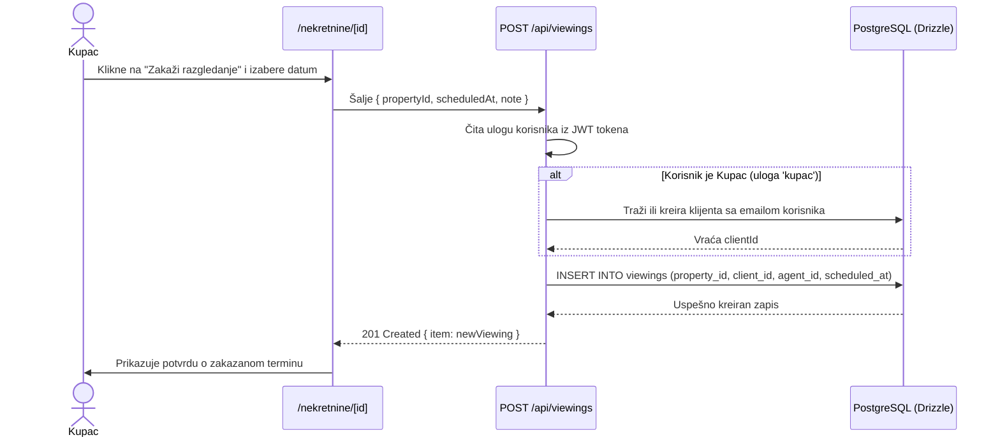
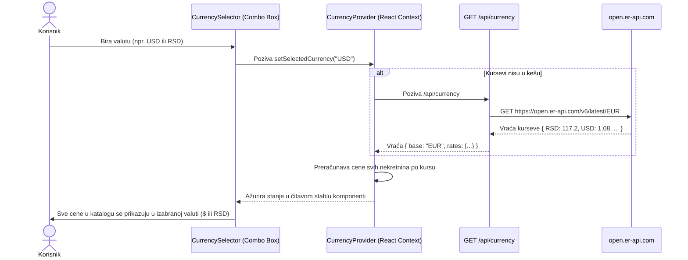
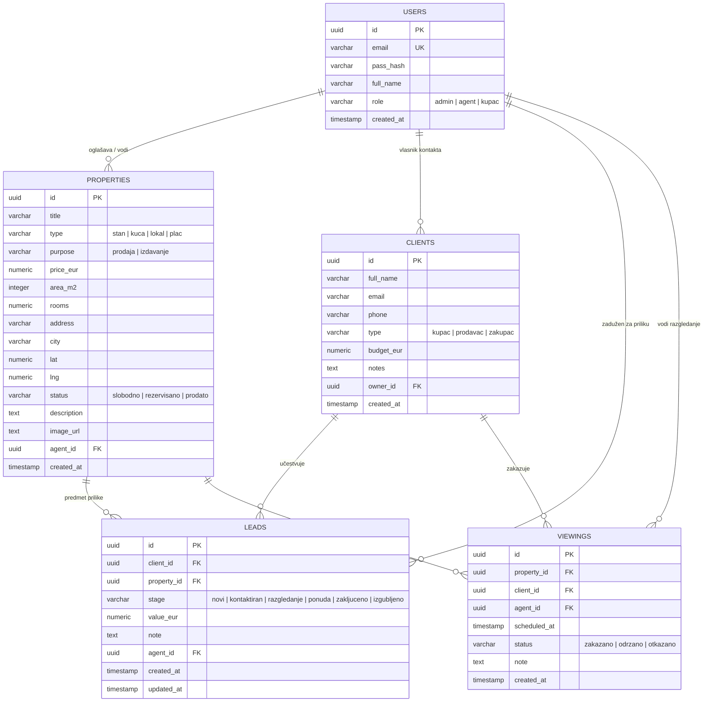

# Tehnička dokumentacija projekta: CRM Aplikacija za promet nekretnina
**Fakultet organizacionih nauka (FON) | Katedra za elektronsko poslovanje**  
**Predmet:** Internet tehnologije (ITEH) | Školska godina: 2026/2027  
**Student:** Vuk Laketić (broj indeksa: 2023/0013)  
**Link ka javnom GitHub repozitorijumu:** [https://github.com/vuklaketic/internet-tehnologije-projekat-crm-nekretnine_2023_0013](https://github.com/vuklaketic/internet-tehnologije-projekat-crm-nekretnine_2023_0013)

---

## 1. Specifikacija zahteva

### 1.1. Funkcionalni zahtevi
1. **Autentifikacija, autorizacija i tri korisničke uloge:**
   - Korisnik se može registrovati kao administrator, agent ili kupac (običan korisnik).
   - Prijava na sistem vrši se putem email adrese i lozinke uz hešovanje lozinki pomoću `bcrypt` (10 rundi).
   - Očuvanje sesije realizovano je upotrebom JWT tokena (HS256) u `httpOnly` i `sameSite: lax` kolačiću (`auth`).
   - Implementiran oporavak zaboravljene lozinke (`/zaboravljena-lozinka`) sa resetovanjem u bazi.
   - Sistem podržava tri nivoa privilegija (RBAC):
     - `admin`: globalno upravljanje celokupnim poslovanjem agencije, nekretninama, klijentima, prodajnim prilikama i analitikom.
     - `agent`: upravljanje sopstvenim nekretninama, klijentima i Kanban prodajnim levkom.
     - `kupac`: uvid u javni katalog sa pretragom, sortiranjem i mapom lokacije, zakazivanje razgledanja i pregled isključivo sopstvenih zakazanih termina ("Moja razgledanja").
2. **Katalog nekretnina sa sortiranjem i uploadom:**
   - Prikaz nekretnina uz filtriranje po statusu (slobodno, rezervisano, prodato) i tipu objekta (stan, kuća, lokal, plac).
   - Tekstualna pretraga po naslovu, adresi i gradu.
   - Sortiranje po 5 kriterijuma: najnovije, cena rastuće/opadajuće, kvadratura manja/veća.
   - Otpremanje fotografija nekretnina na server sa diska (JPG, PNG, WebP do 5MB) ili unos eksternog URL-a.
   - Paginacija rezultata i detaljan pregled nekretnine sa interaktivnom OpenStreetMap mapom.
   - Izvoz podataka u standardni CSV format.
3. **Upravljanje klijentima (CRM):**
   - Evidencija kupaca, prodavaca i zakupaca uz kontakt podatke i budžet.
   - Agenti imaju pristup sopstvenim klijentima, dok administrator ima globalni uvid.
4. **Prodajni levak (Kanban tabla prodajnih prilika):**
   - Vizuelno praćenje statusa poslova po fazama: *Novi*, *Kontaktiran*, *Razgledanje*, *Ponuda*, *Zaključeno*, *Izgubljeno*.
   - Ažuriranje statusa i finansijskog obima prilike u realnom vremenu.
5. **Zakazivanje i evidencija razgledanja (Viewings):**
   - Zakazivanje termina obilaska nekretnine sa klijentom, dodela agenta, beleženje datuma i statusa (zakazano, održano, otkazano).
   - Kupac može direktno sa stranice nekretnine zakazati razgledanje za sebe.
6. **Eksterni javni veb servisi (Zahtev za ocenu 10):**
   - **Open Exchange Rates API (`open.er-api.com`):** Dohvatanje kurseva valuta (EUR, RSD, USD, CHF, GBP) sa serverskim keširanjem (1h). Globalni Combo Box birač valuta automatski konvertuje i formatira cene svih nekretnina u čitavoj aplikaciji.
   - **OpenStreetMap Nominatim API + Leaflet:** Geokodiranje adresa u geografske koordinate (`lat`, `lng`) i interaktivno renderovanje mapa sa namenskim pinovima.

### 1.2. Nefunkcionalni zahtevi
- **Performanse:** Korišćenje Server-Side Renderinga (SSR), React Server Components i memorijskog keširanja eksternih API odgovora.
- **Sigurnost:** Drizzle ORM parametrizovani SQL upiti (imunost na SQL Injection), `httpOnly` kolačići (imunost na XSS krađu sesije), Zod schema validacija tela zahteva.
- **Konzistentan dizajn:** Moderan i responzivan korisnički interfejs stilizovan pomoću Tailwind CSS radnog okvira sa dark-mode podrškom i Remix Icon vektorskim ikonicama.

---

## 2. Dijagram slučajeva korišćenja (Use-Case Diagram)



---

## 3. Arhitektura sistema i dijagram komponenti

Sistem je realizovan po višeslojnom obrascu primenom Next.js 16 (App Router) arhitekture:



---

## 4. Dijagrami procesa slučajeva korišćenja (Dijagrami sekvenci)

### 4.1. Sekvenca autentifikacije korisnika i postavljanja JWT sesije

```mermaid
sequenceDiagram
    actor Korisnik
    participant Klijent as Klijentski Browser (React)
    participant AuthAPI as POST /api/auth/login
    participant DB as PostgreSQL (Drizzle)

    Korisnik->>Klijent: Unosi email i lozinku
    Klijent->>AuthAPI: Šalje JSON { email, password }
    AuthAPI->>DB: SELECT * FROM users WHERE email = ?
    DB-->>AuthAPI: Vraća korisnika sa pass_hash
    AuthAPI->>AuthAPI: Proverava lozinku sa bcrypt.compare
    alt Lozinka ispravna
        AuthAPI->>AuthAPI: Generiše potpisan JWT (HS256)
        AuthAPI-->>Klijent: 200 OK + Set-Cookie: auth=<jwt>; HttpOnly; SameSite=Lax
        Klijent->>Korisnik: Preusmerava na kontrolnu tablu (/)
    else Neispravna lozinka
        AuthAPI-->>Klijent: 401 Unauthorized { error: "Pogrešna lozinka" }
        Klijent->>Korisnik: Prikazuje poruku o grešci
    end
```

### 4.2. Sekvenca zakazivanja razgledanja nekretnine



### 4.3. Sekvenca multivalutne konverzije cena (open.er-api.com)



---

## 5. Model podataka (PMOV / ER Dijagram)



---

## 6. Realizacija migracija nad bazom podataka (5 tipova operacija)

U skladu sa ispitnim zahtevom za najmanje 5 različitih tipova migracija, u `src/db/migrations` realizovane su sledeće operacije:
1. **Kreiranje tabela (`CREATE TABLE`):** Inicijalno kreiranje tabela modela (`users`, `properties`, `clients`, `leads`, `viewings`, `activities`).
2. **Definisanje spoljnih ključeva (`ADD CONSTRAINT ... FOREIGN KEY`):** Uspostavljanje referencijalnog integriteta sa `ON DELETE CASCADE` i `ON DELETE SET NULL`.
3. **Definisanje unikatnih ograničenja (`CONSTRAINT ... UNIQUE`):** Sprečavanje unosa duplikata za email adresu korisnika.
4. **Izmena postojeće kolone i default vrednosti (`ALTER TABLE ... ALTER COLUMN ... SET DEFAULT`):** Izmena kolone `role` i postavljanje uloge `kupac` kao podrazumevane.
5. **Kreiranje B-tree indeksa za optimizaciju upita (`CREATE INDEX`):** Kreirani indeksi nad `city`, `type` i `status` kolonama u tabeli `properties`.

---

## 7. Specifikacija REST API-ja

| Metoda | Endpoint | Opis funkcije | Autentifikacija | HTTP Status kodovi |
| :--- | :--- | :--- | :---: | :---: |
| `POST` | `/api/auth/login` | Prijava korisnika i postavljanje HTTP-Only JWT kolačića | Ne | 200, 400, 401 |
| `POST` | `/api/auth/register` | Registracija novog korisnika (admin, agent ili kupac) | Ne | 201, 400 |
| `POST` | `/api/auth/reset-password` | Oporavak i promena zaboravljene lozinke | Ne | 200, 400, 404 |
| `GET` | `/api/auth/me` | Podaci o trenutno prijavljenom korisniku | Da (JWT) | 200, 401 |
| `POST` | `/api/auth/logout` | Odjava i uklanjanje autentifikacionog kolačića | Da (JWT) | 200 |
| `GET` | `/api/properties` | Paginirani katalog sa pretragom, filterima i sortiranjem | Da (JWT) | 200, 401 |
| `POST` | `/api/properties` | Unos nove nekretnine (validacija putem Zod-a) | Da (Admin/Agent) | 201, 400, 401 |
| `GET` | `/api/properties/[id]` | Detaljan prikaz nekretnine sa podacima agenta i koordinatama | Da (JWT) | 200, 404 |
| `PUT` | `/api/properties/[id]` | Ažuriranje podataka o nekretnini | Da (Admin/Agent) | 200, 403 |
| `DELETE`| `/api/properties/[id]` | Brisanje nekretnine iz baze | Da (Admin/Agent) | 200, 403 |
| `POST` | `/api/upload` | Otpremanje fotografije nekretnine na server (do 5MB) | Da (JWT) | 201, 400, 401 |
| `GET` | `/api/clients` | Baza klijenata (filtrirana po vlasniku i ulogama) | Da (Admin/Agent) | 200, 401 |
| `POST` | `/api/clients` | Evidencija novog klijenta (kupac, prodavac, zakupac) | Da (Admin/Agent) | 201, 400 |
| `DELETE`| `/api/clients/[id]` | Brisanje klijenta iz baze | Da (Admin/Agent) | 200, 403 |
| `GET` | `/api/leads` | Prikaz prodajnih prilika po fazama za Kanban tablu | Da (Admin/Agent) | 200, 401 |
| `POST` | `/api/leads` | Kreiranje nove prodajne prilike u levku | Da (Admin/Agent) | 201, 400 |
| `PUT` | `/api/leads/[id]` | Pomeranje faze prilike (npr. u 'ponuda' ili 'zaključeno') | Da (Admin/Agent) | 200, 400 |
| `GET` | `/api/viewings` | Raspored razgledanja (sopstvena za kupca, sva za agenciju) | Da (JWT) | 200, 401 |
| `POST` | `/api/viewings` | Zakazivanje novog termina obilaska nekretnine | Da (JWT) | 201, 400 |
| `GET` | `/api/currency` | Dohvatanje live kurseva valuta preko open.er-api.com | Ne | 200, 500 |
| `GET` | `/api/openapi.json` | OpenAPI 3.0 mašinski čitljiva JSON specifikacija | Ne | 200 |

---

## 8. Mesta za snimke ekrana aplikacije (Screenshots)

1. **Slika 1 – Prijava na sistem (`/login`):** Forma sa poljima za email, lozinku, linkom za oporavak lozinke i demo nalozima za 3 uloge.
2. **Slika 2 – Oporavak zaboravljene lozinke (`/zaboravljena-lozinka`):** Forma za resetovanje lozinke sa potvrdom i automatskim preusmeravanjem.
3. **Slika 3 – Kontrolna tabla (`/`):** Prikaz ključnih poslovnih kartica, Recharts grafikona distribucije po fazama, tipovima objekata i učinku agenata.
4. **Slika 4 – Katalog nekretnina (`/nekretnine`):** Prikaz kartica, pretrage, filtera, birača valuta (Combo Box) i menija za sortiranje po kriterijumima.
5. **Slika 5 – Modal za dodavanje nekretnine:** Forma sa opcijom otpremanja slike sa diska uz live preview ili unos eksternog URL-a.
6. **Slika 6 – Detaljan prikaz nekretnine (`/nekretnine/[id]`):** Prikaz karakteristika, cene sa multivalutnom konverzijom, podacima agenta i Leaflet interaktivne mape.
7. **Slika 7 – Prodajne prilike (`/leadovi`):** Kanban tabla sa kolonama po fazama pregovora.
8. **Slika 8 – Baza klijenata (`/klijenti`):** Tabelarni prikaz kupaca/prodavaca sa dugmetom za preuzimanje CSV izveštaja.
9. **Slika 9 – Zakazana razgledanja (`/razgledanja`):** Prikaz termina po datumima i modal za zakazivanje.
10. **Slika 10 – Interaktivna API dokumentacija (`/api-docs`):** Swagger/OpenAPI vizuelni pregled svih dostupnih ruta.

---

## 9. Reprezentativni delovi koda

### 9.1. Multivalutni birač i automatska konverzija cena (`src/context/currency-context.tsx`)
```typescript
export function CurrencySelector({ className = '' }: { className?: string }) {
  const { selectedCurrency, setSelectedCurrency, rates } = useCurrencyContext();

  return (
    <select
      value={selectedCurrency}
      onChange={(e) => setSelectedCurrency(e.target.value as CurrencyCode)}
      aria-label="Izbor valute za konverziju cena"
      className="text-xs font-semibold px-2.5 py-1.5 rounded-lg border border-slate-200 bg-white cursor-pointer"
    >
      <option value="EUR">EUR (€)</option>
      <option value="RSD">RSD ({rates.RSD?.toFixed(1) || 117.2})</option>
      <option value="USD">USD ($)</option>
      <option value="CHF">CHF</option>
      <option value="GBP">GBP (£)</option>
    </select>
  );
}
```

### 9.2. React Custom Hook za dohvatanje nekretnina (`src/hooks/useProperties.ts`)
```typescript
export function useProperties({ page = 1, pageSize = 6, q = '', status = '', type = '', sort = 'newest' }) {
  const [properties, setProperties] = useState<any[]>([]);
  const [total, setTotal] = useState(0);
  const [loading, setLoading] = useState(true);

  const fetchProperties = useCallback(async () => {
    setLoading(true);
    const params = new URLSearchParams({ page: String(page), pageSize: String(pageSize), q, status, type, sort });
    const res = await fetch(`/api/properties?${params.toString()}`);
    if (res.ok) {
      const data = await res.json();
      setProperties(data.items || []);
      setTotal(data.total || 0);
    }
    setLoading(false);
  }, [page, pageSize, q, status, type, sort]);

  useEffect(() => { fetchProperties(); }, [fetchProperties]);

  return { properties, total, loading, refetch: fetchProperties };
}
```

### 9.3. Geokodiranje i interaktivna Leaflet mapa lokacije (`src/components/map/property-map.tsx`)
```typescript
useEffect(() => {
  async function geocodeAddress() {
    if (initialLat && initialLng) {
      setCoords([Number(initialLat), Number(initialLng)]);
      return;
    }
    const query = encodeURIComponent(`${address}, ${city}, Serbia`);
    const res = await fetch(`https://nominatim.openstreetmap.org/search?format=json&q=${query}&limit=1`, {
      headers: { 'User-Agent': 'CRM-Nekretnine-FON/1.0' },
    });
    const data = await res.json();
    if (data && data.length > 0) {
      setCoords([parseFloat(data[0].lat), parseFloat(data[0].lon)]);
    }
  }
  geocodeAddress();
}, [address, city, initialLat, initialLng]);
```
