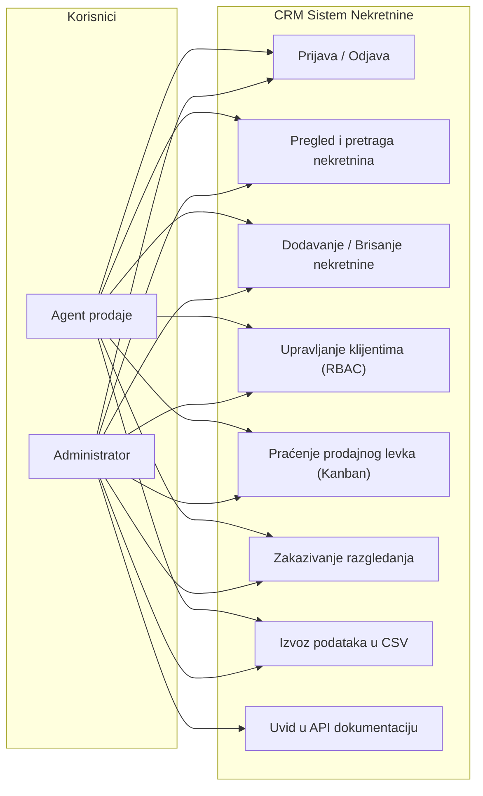
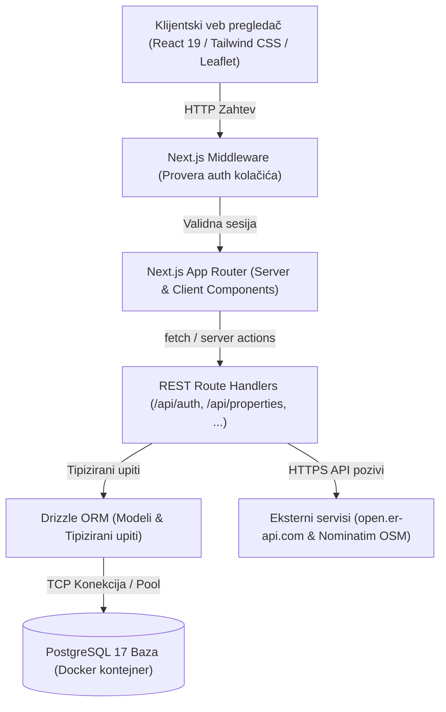
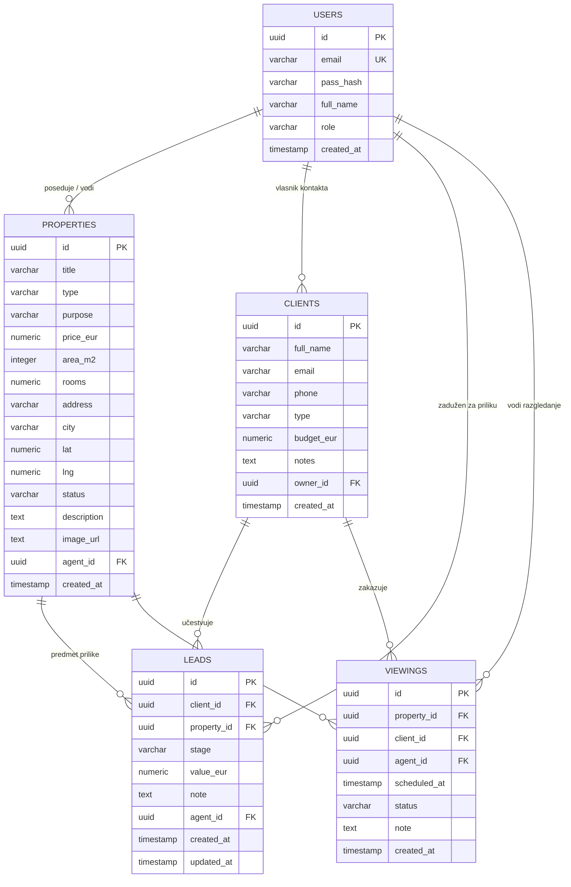

# Tehnička dokumentacija projekta: CRM Aplikacija za promet nekretnina
**Fakultet organizacionih nauka (FON) | Katedra za elektronsko poslovanje**  
**Predmet:** Internet tehnologije (ITEH) | Školska godina: 2026/2027  
**Student:** Vuk Laketić (broj indeksa: 2023/0013)  
**Link ka GitHub repozitorijumu:** [https://github.com/vuklaketic/internet-tehnologije-projekat-crm-nekretnine_2023_0013](https://github.com/vuklaketic/internet-tehnologije-projekat-crm-nekretnine_2023_0013)

---

## 1. Specifikacija zahteva

### 1.1. Funkcionalni zahtevi
1. **Autentifikacija i autorizacija:**
   - Korisnik se može registrovati kao agent ili administrator.
   - Prijava na sistem vrši se upotrebom email adrese i lozinke.
   - Čuvanje sesije realizovano je putem JWT tokena (HS256) skladištenog u sigurnom `httpOnly` istopolnom kolačiću (`auth`).
   - Sistem prepoznaje dve uloge: `admin` (globalni pristup) i `agent` (pristup sopstvenim podacima).
2. **Katalog nekretnina:**
   - Prikaz svih nekretnina uz filtriranje po statusu (slobodno, rezervisano, prodato) i tipu objekta (stan, kuća, lokal, plac).
   - Pretraga po ključnim rečima (naziv, adresa, grad).
   - Paginacija rezultata i detaljan prikaz pojedinačne nekretnine sa interaktivnom mapom lokacije.
   - Izvoz podataka o nekretninama u CSV formatu.
3. **Upravljanje klijentima:**
   - Evidencija kupaca, prodavaca i zakupaca uz kontakt podatke i okvirni budžet.
   - Role-Based Access Control (RBAC): agenti mogu videti i menjati samo klijente čiji su vlasnici.
4. **Prodajni levak (Leads & Kanban):**
   - Vizuelno praćenje statusa pregovora kroz faze: *Novi*, *Kontaktiran*, *Razgledanje*, *Ponuda*, *Zaključeno*, *Izgubljeno*.
   - Promena faze preko Kanban table ili tabelarnog prikaza.
5. **Raspored razgledanja (Viewings):**
   - Zakazivanje termina obilaska nekretnine sa klijentom uz definisanje datuma, vremena i instrukcija za teren.
6. **Eksterni API servisi:**
   - Prikaz zvaničnog srednjeg kursa EUR/RSD u realnom vremenu uz serversko keširanje od 1h (`open.er-api.com`).
   - Geokodiranje adrese nekretnine preko OpenStreetMap Nominatim API-ja i renderovanje lokacije pomoću Leaflet mape.

### 1.2. Nefunkcionalni zahtevi
- **Performanse:** Korišćenje Server-Side Renderinga (SSR) i keširanja eksternih API odgovora.
- **Bezbednost:** Hešovanje lozinki algoritmom `bcrypt` (10 rundi), parametrizovani SQL upiti kroz Drizzle ORM za zaštitu od SQL injection napada, `httpOnly` kolačići protiv XSS krađe sesije, Zod validacija ulaznih parametara.
- **Responzivnost:** Prilagođen interfejs za desktop, tablet i mobilne ekrane korišćenjem Tailwind CSS-a.

---

## 2. Dijagram slučajeva korišćenja (Use-Case Diagram)



---

## 3. Arhitektura sistema

Sistem je organizovan po višeslojnoj arhitekturi u skladu sa Next.js App Router obrascem:



---

## 4. Dijagram baze podataka (ER Diagram)



---

## 5. Spisak implementiranih REST API ruta

| Metoda | Putanja | Opis | Autentifikacija |
| :--- | :--- | :--- | :---: |
| `POST` | `/api/auth/login` | Prijava korisnika i postavljanje `auth` cookie-ja | Ne |
| `POST` | `/api/auth/register` | Registracija novog agenta / admina | Ne |
| `GET` | `/api/auth/me` | Podaci o ulogovanom korisniku | Da (JWT) |
| `POST` | `/api/auth/logout` | Odjava i uklanjanje kolačića | Da (JWT) |
| `GET` | `/api/properties` | Paginirani katalog nekretnina sa pretragom | Da (JWT) |
| `POST` | `/api/properties` | Kreiranje nove nekretnine (Zod validacija) | Da (JWT) |
| `GET` | `/api/properties/[id]` | Detalji pojedinačne nekretnine | Da (JWT) |
| `PUT` | `/api/properties/[id]` | Ažuriranje nekretnine (RBAC provera) | Da (JWT) |
| `DELETE`| `/api/properties/[id]` | Brisanje nekretnine | Da (JWT) |
| `GET` | `/api/clients` | Baza klijenata (filtrirana po vlasniku) | Da (JWT) |
| `POST` | `/api/clients` | Dodavanje novog klijenta | Da (JWT) |
| `DELETE`| `/api/clients/[id]` | Brisanje klijenta iz baze | Da (JWT) |
| `GET` | `/api/leads` | Prodajne prilike po fazama | Da (JWT) |
| `POST` | `/api/leads` | Kreiranje prodajne prilike | Da (JWT) |
| `PUT` | `/api/leads/[id]` | Pomeranje faze u levku (Kanban) | Da (JWT) |
| `GET` | `/api/viewings` | Raspored termina razgledanja | Da (JWT) |
| `POST` | `/api/viewings` | Zakazivanje novog termina | Da (JWT) |
| `GET` | `/api/currency` | Srednji kurs EUR/RSD preko javnog API-ja | Ne |
| `GET` | `/api/openapi.json` | OpenAPI 3.0 mašinski čitljiva specifikacija | Ne |

---

## 6. Mesta za snimke ekrana aplikacije (Screenshots)

*(U finalnom PDF dokumentu ovde se ubacuju snimci ekrana pokrenute aplikacije)*

1. **Slika 1:** Ekran za prijavu na sistem (`/login`) sa validacijom grešaka.
2. **Slika 2:** Kontrolna tabla (Dashboard) sa metrikama, karticama i Recharts grafikonima distribucije.
3. **Slika 3:** Katalog nekretnina (`/nekretnine`) sa primenjenim filterima i paginacijom.
4. **Slika 4:** Detaljan prikaz nekretnine (`/nekretnine/[id]`) sa konverzijom valuta i Leaflet mapom lokacije.
5. **Slika 5:** Kanban tabla prodajnih prilika (`/leadovi`) sa fazama pregovora.
6. **Slika 6:** Evidencija klijenata i opcija izvoza u CSV fajl (`/klijenti`).
7. **Slika 7:** Raspored zakazanih razgledanja nekretnina (`/razgledanja`).
8. **Slika 8:** Interaktivna API dokumentacija (`/api-docs`).

---

## 7. Ključni isečci izvornog koda

### 7.1. Verifikacija JWT sesije i provera korisnika (`src/lib/auth.ts`)
```typescript
export async function getCurrentUser() {
  const cookieStore = await cookies();
  const token = cookieStore.get(AUTH_COOKIE)?.value;
  if (!token) return null;

  const payload = verifyAuthToken(token);
  if (!payload || !payload.userId) return null;

  const [user] = await db
    .select({
      id: users.id,
      email: users.email,
      fullName: users.fullName,
      role: users.role,
      createdAt: users.createdAt,
    })
    .from(users)
    .where(eq(users.id, payload.userId));

  return user || null;
}
```

### 7.2. Bezbedno hešovanje lozinke i seed baze (`src/db/seed.ts`)
```typescript
const passHash = await bcrypt.hash('Test1234!', 10);

await db.insert(users).values([
  {
    id: 'a0000000-0000-0000-0000-000000000001',
    email: 'admin@crm.rs',
    passHash,
    fullName: 'Vuk Laketić (Administrator)',
    role: 'admin',
  },
  // agenti...
]);
```
